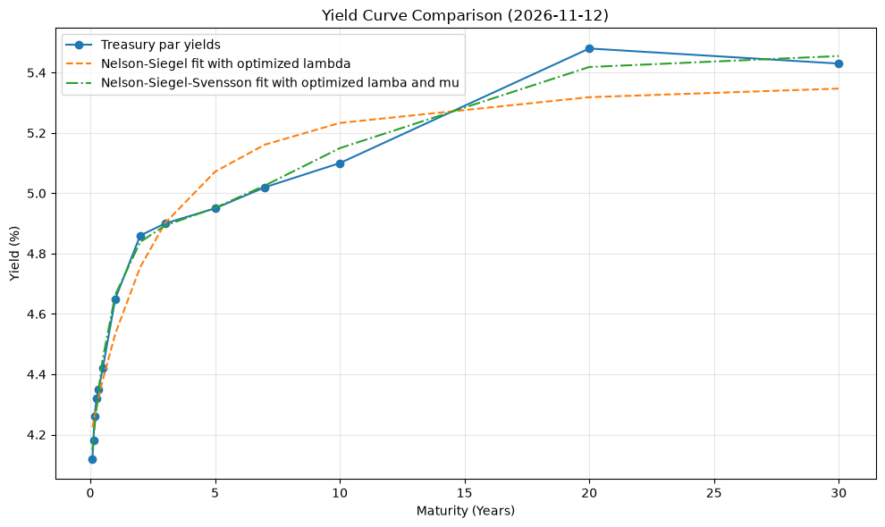

# Fixed Income Analytics
Yield curve construction

Fixed income analytics and interest rate modeling

**Library functionalities:**
 * Download and clean US treasury par yields,
 * Fit Nelson-Siegel (NS) and Nelson-Siegel-Svensson (NSS) curves,
 * Calibrate parameters of NS and NSS models.

Notebooks provide a demonstration of the package's functionalities.

## Example curve fitting
As an example, we fit NS and NSS curves to US treasury par yields on a specific date. It is important to consider that US treasury par yields are not observed rates of market instruments; they are derived by fitting a curve to bid-side market price quotations. Therefore, fitting NS and NSS curves does not independently reconstruct a yield curve however they can provide estimates for missing maturities.

### The following chart compares the calibrated NS and NSS yield curves using line search and grid search, respectively:

